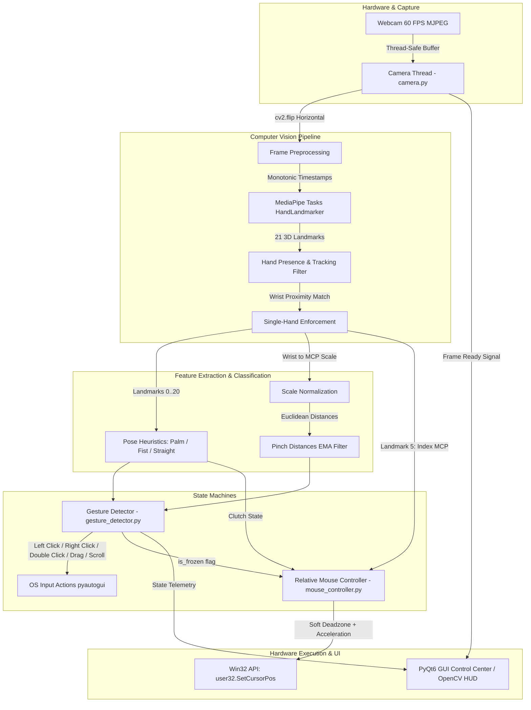

# Touchless – AI Vision Air Mouse & Gesture Desktop Control System

[](https://www.python.org/)
[](https://opencv.org/)
[](https://developers.google.com/mediapipe)
[](https://www.riverbankcomputing.com/software/pyqt/)
[-0078D6.svg)](https://learn.microsoft.com/en-us/windows/win32/)

**Touchless** is a real-time, vision-based contactless human-computer interface (Air Mouse) that transforms any standard webcam into a high-precision, trackpad-style desktop controller. Utilizing state-of-the-art 21-landmark 3D hand tracking, low-level Win32 hardware cursor hooks, scale-invariant pinch algorithms, and dual-clutch state machines, Touchless offers smooth, jitter-free cursor manipulation, clicking, dragging, and directional scrolling without physical contact.

---

## Table of Contents
1. [Key Features](#key-features)
2. [System Architecture](#system-architecture)
3. [Mathematical & Algorithmic Foundations](#mathematical--algorithmic-foundations)
   - [Trackpad-Style Relative Mapping & Acceleration](#trackpad-style-relative-mapping--acceleration)
   - [Soft Dead-Zone Tremor Filter](#soft-dead-zone-tremor-filter)
   - [Exponential Smoothing Filter](#exponential-smoothing-filter)
   - [Scale-Invariant Pinch Normalization & Hysteresis](#scale-invariant-pinch-normalization--hysteresis)
   - [Rotation-Invariant Hand Pose Classification](#rotation-invariant-hand-pose-classification)
4. [Gesture Control Mapping](#gesture-control-mapping)
5. [Technical Module Breakdown](#technical-module-breakdown)
   - [`camera.py` – Asynchronous MJPEG Acquisition](#camerapy--asynchronous-mjpeg-acquisition)
   - [`hand_tracker.py` – MediaPipe Tasks HandLandmarker Engine](#hand_trackerpy--mediapipe-tasks-handlandmarker-engine)
   - [`mouse_controller.py` – Win32 Displacement Controller](#mouse_controllerpy--win32-displacement-controller)
   - [`gesture_detector.py` – Multi-Modal Gesture State Machine](#gesture_detectorpy--multi-modal-gesture-state-machine)
   - [`gui.py` – PyQt6 Control Center](#guipy--pyqt6-control-center)
   - [`main.py` – Standalone OpenCV HUD Runtime](#mainpy--standalone-opencv-hud-runtime)
6. [Directory Structure](#directory-structure)
7. [Dependencies & Technology Stack](#dependencies--technology-stack)
8. [Installation & Setup](#installation--setup)
9. [Running the Application](#running-the-application)
10. [Packaging & Distribution (PyInstaller & PyArmor)](#packaging--distribution-pyinstaller--pyarmor)
11. [Performance Optimization & Low-Latency Tips](#performance-optimization--low-latency-tips)

---

## Key Features

- **Relative Cursor Displacement (Trackpad Paradigm)**: Emulates a physical mouse/trackpad by calculating incremental deltas rather than absolute screen mapping, preventing camera-boundary trapping and neck strain.
- **MCP Knuckle Tracking**: Anchors cursor control to the Index Finger Metacarpophalangeal (MCP) knuckle (Landmark 5) rather than the fingertip. This prevents cursor displacement when flexing fingers during clicks.
- **Direct Win32 Hardware-Level Control**: Uses native Windows `ctypes.windll.user32.SetCursorPos` and `GetCursorPos` for sub-millisecond cursor injection bypassing input event queue latency.
- **Soft Dead-Zone Tremor Suppression**: Employs non-linear dampening to filter out physiological human tremors and sensor noise during static hovering without introducing input latency.
- **Dynamic Velocity-Based Acceleration**: Cursor speed scales quadratically with hand movement speed, enabling effortless multi-monitor sweeps with slow, pixel-accurate precision pointing.
- **Dual Clutching (Ratchet Movement)**: Reposition your hand freely without moving the cursor by curling into a fist or breaking hand presence. The system continuously syncs coordinates to eliminate cursor jumps on re-engagement.
- **Click Freeze Lock**: Temporarily locks cursor coordinates during click gesture execution to prevent accidental mouse slip while pinching.
- **Scale-Invariant Normalized Pinches**: Pinch distances are dynamically scaled relative to the user's hand size ($L_0$ to $L_9$), ensuring consistent gesture sensitivity whether 30 cm or 2 meters from the lens.
- **Anti-Misfire Finger Isolation**: Pinches are validated against secondary finger extension states, preventing false triggers during fists or rapid hand repositioning.
- **Dual-Mode Directional Scrolling**: Continuous vertical scrolling driven by finger curl velocity transitions with built-in dead-zones and momentum accumulation.
- **Dual Interface Design**:
  - **PyQt6 Control Center**: Multithreaded GUI with real-time sensitivity and smoothing sliders, live telemetry cards, and a draggable, always-on-top picture-in-picture floating preview.
  - **OpenCV Lightweight HUD**: Standalone console-backed window with high Win32 process priority (`0x00000080`), corner decorations, and transparent alpha-blended telemetry.

---

## System Architecture



---

## Mathematical & Algorithmic Foundations

### Trackpad-Style Relative Mapping & Acceleration

Instead of mapping webcam pixel coordinates directly to display resolution, Touchless computes instantaneous spatial displacement vectors $\Delta x$ and $\Delta y$:

$$\Delta x_{\text{raw}} = x_{\text{smooth}}^{(t)} - x_{\text{smooth}}^{(t-1)}$$
$$\Delta y_{\text{raw}} = y_{\text{smooth}}^{(t)} - y_{\text{smooth}}^{(t-1)}$$

To provide both micro-precision adjustments and sweeping multi-monitor traversals, a non-linear velocity acceleration function is applied:

$$v = \sqrt{(\Delta x_{\text{clean}})^2 + (\Delta y_{\text{clean}})^2}$$
$$M(v) = S \cdot (1.0 + \gamma \cdot v)$$

Where:
- $S$ is the user sensitivity multiplier (default `8.5`).
- $\gamma$ is the acceleration coefficient (default `0.08`).
- $\Delta x_{\text{clean}}, \Delta y_{\text{clean}}$ are dead-zone filtered displacements.

The final screen displacement vector is:

$$\vec{D}_{\text{screen}} = \begin{bmatrix} \Delta x_{\text{clean}} \cdot M(v) \\ \Delta y_{\text{clean}} \cdot M(v) \end{bmatrix}$$

### Soft Dead-Zone Tremor Filter

A hard dead-zone creates a jarring "sticking" effect when movement starts. Touchless applies a continuous soft dead-zone transfer function that eliminates micro-tremors below threshold $\tau_{\text{dead}}$ (`1.2` px) and smoothly transitions into active motion:

$$\text{scale} = \begin{cases} 0, & \text{if } v < \tau_{\text{dead}} \\ \dfrac{v - \tau_{\text{dead}}}{v}, & \text{if } v \ge \tau_{\text{dead}} \end{cases}$$

$$\vec{\Delta}_{\text{clean}} = \vec{\Delta}_{\text{raw}} \cdot \text{scale}$$

### Exponential Smoothing Filter

Coordinate jitter is mitigated using First-Order Exponential Smoothing on the input stream prior to delta calculation:

$$\vec{P}_{\text{smooth}}^{(t)} = (1 - \alpha_{\text{smooth}}) \cdot \vec{P}_{\text{smooth}}^{(t-1)} + \alpha_{\text{smooth}} \cdot \vec{P}_{\text{raw}}^{(t)}$$

Where $\alpha_{\text{smooth}} \in [0.05, 0.95]$ (default `0.55`). Higher smoothing values favor responsiveness, while lower values eliminate high-frequency jitter.

### Scale-Invariant Pinch Normalization & Hysteresis

To enable pinch gestures to operate identically regardless of whether the hand is close to or far from the camera, all inter-landmark Euclidean distances are normalized by the anatomical hand scale reference length $L_{\text{scale}}$, defined as the distance between the Wrist (Landmark 0) and the Middle MCP joint (Landmark 9):

$$L_{\text{scale}} = \|\mathbf{p}_0 - \mathbf{p}_9\|_2$$
$$d_{\text{norm}}(i, j) = \frac{\|\mathbf{p}_i - \mathbf{p}_j\|_2}{L_{\text{scale}}}$$

Distances are filtered using an Exponential Moving Average ($\alpha_{\text{EMA}} = 0.8$):

$$\bar{d}^{(t)} = (1 - \alpha_{\text{EMA}}) \cdot \bar{d}^{(t-1)} + \alpha_{\text{EMA}} \cdot d_{\text{norm}}^{(t)}$$

A dual-threshold Schmitt trigger (hysteresis) prevents edge chatter:

$$\text{Pinch State} = \begin{cases} \text{Active}, & \text{if } \bar{d} < \tau_{\text{pinch}} \quad (\tau = 0.18) \\ \text{Retained}, & \text{if active and } \bar{d} < (\tau_{\text{pinch}} + \tau_{\text{hyst}}) \quad (\tau_{\text{hyst}} = 0.04) \\ \text{Inactive}, & \text{otherwise} \end{cases}$$

### Rotation-Invariant Hand Pose Classification

- **Open Palm**: All 4 finger tips (Landmarks 8, 12, 16, 20) are farther from the wrist than their respective PIP joints (Landmarks 6, 10, 14, 18):
  $$\|\mathbf{p}_{\text{tip}_i} - \mathbf{p}_{\text{wrist}}\|_2 > \|\mathbf{p}_{\text{PIP}_i} - \mathbf{p}_{\text{wrist}}\|_2 \quad \forall i \in \{\text{Index, Middle, Ring, Pinky}\}$$
- **Fist Detection with Foreshortening Compensation**: When pointing the index finger directly at the camera lens, z-axis foreshortening causes the 2D projection of tip 8 to overlap knuckle 6. Touchless checks if middle, ring, and pinky are folded, and verifies:
  $$\|\mathbf{p}_8 - \mathbf{p}_0\|_2 \le 1.15 \cdot \|\mathbf{p}_{12} - \mathbf{p}_0\|_2$$
  If tip 8 extends beyond $1.15 \times$ the folded middle fingertip, it is classified as pointing rather than a fist.

---

## Gesture Control Mapping

| Action | Hand Pose / Gesture | Active Landmarks | Activation Logic & State Rules |
| :--- | :--- | :--- | :--- |
| **Cursor Move** | Open Palm + Index Tracking | Landmark 5 (Index MCP) | Open palm detected; MCP knuckle deltas drive Win32 cursor displacement. |
| **Clutch (Pause)** | Fist / Finger Curl | Landmarks 0–20 | Cursor movement paused; allows repositioning hand without moving cursor. |
| **Left Click** | Thumb + Index Tip Pinch | Landmark 4 + Landmark 8 | Normalized pinch $< 0.18$. Held for $< 0.5\text{s}$ and released. Cursor frozen during click. |
| **Drag & Drop** | Hold Thumb + Index Pinch | Landmark 4 + Landmark 8 | Pinch maintained for $> 0.5\text{s}$. Triggers `mouseDown()`; allows relative dragging; releases on unpinch (`mouseUp()`). |
| **Right Click** | Thumb + Middle Tip Pinch | Landmark 4 + Landmark 12 | Normalized distance $< 0.18$. Triggers `rightClick()`. Requires index, ring, and pinky extended to prevent misfires. |
| **Double Click** | Thumb + Ring Tip Pinch | Landmark 4 + Landmark 16 | Normalized distance $< 0.18$. Triggers `doubleClick()`. Requires index, middle, and pinky extended. |
| **Scroll Down** | Fist $\rightarrow$ Two-Finger Extension | Landmarks 8, 12 (relative to 5, 9) | Initiated from fist state, curling/extending index and middle upward with ring and pinky closed. |
| **Scroll Up** | Open Palm $\rightarrow$ Finger Curl | Landmarks 8, 12 (relative to 5, 9) | Initiated from open palm state, curling index and middle downward. |

---

## Technical Module Breakdown

### `camera.py` – Asynchronous MJPEG Acquisition
- Utilizes OpenCV's Windows DirectShow backend (`cv2.CAP_DSHOW`) to bypass Media Foundation overhead.
- Requests hardware MJPEG stream compression (`FOURCC *'MJPG'`) for uncompressed 60 FPS video capture at 640x480 resolution.
- Dedicated background daemon thread continuously drains the hardware buffer into a double buffer protected by `threading.Lock()` and synchronized via `threading.Event()`, preventing frame queue lag.

### `hand_tracker.py` – MediaPipe Tasks HandLandmarker Engine
- Integrates Google MediaPipe Tasks Python API (`vision.HandLandmarker`) operating in `RunningMode.VIDEO`.
- Leverages the float16 quantized landmark bundle (`hand_landmarker.task`, ~7.8 MB). Auto-downloads missing task binaries on first launch.
- Enforces strict monotonic millisecond timestamp advancement required by MediaPipe video inference.
- Implements single-hand persistence matching: calculates Euclidean distance from the current wrist to the previous frame's wrist position to prevent hand-swapping flicker when secondary hands enter the frame.

### `mouse_controller.py` – Win32 Displacement Controller
- Bypasses high-overhead OS event wrappers using direct Win32 API system calls (`user32.GetCursorPos` and `user32.SetCursorPos`) wrapped via `ctypes`.
- Applies the soft dead-zone transfer function, exponential coordinate smoothing, and velocity acceleration.
- Prevents boundary cursor jumps: continuous position history updates while clutched ensure zero-delta resumption when re-engaging.
- Clamps cursor coordinates strictly within physical display dimensions (`pyautogui.size()`).

### `gesture_detector.py` – Multi-Modal Gesture State Machine
- Manages gesture state transitions (`Move`, `Left Click`, `Dragging`, `Right Click`, `Double Click`, `Scroll`).
- Evaluates finger isolation constraints: verifies at least two non-active fingers are extended before permitting click pinch activations to prevent accidental triggers during whole-hand closing.
- Implements directional scroll pose detection with sub-pixel displacement accumulation and dynamic scroll acceleration curves.
- Emits `is_frozen = True` to halt cursor movement during pinch confirmation, preventing click-drag misclicks.

### `gui.py` – PyQt6 Control Center
- High-performance, multi-threaded GUI built with PyQt6.
- Offloads computer vision and tracking to a background `QThread` (`TrackingWorker`), maintaining a responsive 60 FPS UI loop.
- **Dynamic Controls**:
  - Live Sensitivity slider (`1.0` to `15.0`).
  - Live Smoothing slider (`0.05` to `0.95`).
  - Toggleable preview feed to conserve CPU.
  - Frameless always-on-top draggable floating preview window (`FloatingPreviewWindow`).
- Real-time telemetry dashboard cards for active gesture state and smoothed system FPS.
- Premium dark-mode cyber-aesthetic stylesheet with status-coded indicator lights.

### `main.py` – Standalone OpenCV HUD Runtime
- Headless / lightweight alternative with an interactive OpenCV window.
- Elevates process priority class on Windows to `HIGH_PRIORITY_CLASS` (`0x00000080`) to ensure foreground CPU scheduling.
- Semi-transparent HUD overlay panel using OpenCV ROI alpha-blending (`cv2.addWeighted`).
- Win32 `IsIconic` polling checks whether the window is minimized to automatically disable landmark drawing, reducing CPU usage to $< 3\%$.

---

## Directory Structure

```
Air mouse/
├── camera.py             # Asynchronous threaded camera capture (DirectShow + MJPEG)
├── hand_tracker.py       # MediaPipe Tasks HandLandmarker pipeline & pose heuristics
├── mouse_controller.py   # Trackpad displacement, dead-zone filter, and Win32 cursor calls
├── gesture_detector.py   # Pinch recognition, click state machines, and scrolling logic
├── gui.py               # Modern PyQt6 desktop control center & floating preview
├── main.py              # Lightweight OpenCV runtime with high process priority & HUD
├── requirements.txt      # Pinned application runtime dependencies
├── requirements-dev.txt  # Runtime, test, and PyInstaller dependencies
├── hand_landmarker.task  # Pre-trained MediaPipe float16 hand landmark model (7.8 MB)
├── logo.png             # Application brand graphics
├── logo.ico             # Application executable icon
├── Touchless.spec        # PyInstaller specification for obfuscated distribution
├── gui.spec             # PyInstaller specification for standard GUI compilation
└── obf/                 # PyArmor obfuscated release modules for protected distribution
```

---

## Dependencies & Technology Stack

| Dependency | Minimum Version | Role in System |
| :--- | :--- | :--- |
| **Python** | `3.11+` | Core runtime; dependencies are pinned and tested in CI on Python 3.13 |
| **OpenCV (`opencv-contrib-python`)** | `4.13.0.92` | Video capture, frame transforms, and HUD rendering; also satisfies MediaPipe's OpenCV dependency |
| **MediaPipe** | `0.10.35` | Hand landmark detection via Tasks Python API |
| **PyQt6** | `6.11.0` | Modern GUI desktop application and floating window |
| **PyAutoGUI** | `0.9.54` | Click execution, mouse down/up, and wheel scroll events |
| **NumPy** | `2.3.5` | Vector operations and distance calculations |
| **Win32 User32 / Kernel32** | Native (`ctypes`) | Instant cursor positioning and thread priority management |

---

## Installation & Setup

### 1. Prerequisites
- **Operating System**: Windows 10 / Windows 11 (64-bit recommended for Win32 API hooks).
- **Python**: Python 3.11 or higher installed and added to system `PATH`.
- **Webcam**: Any built-in or external USB webcam capable of 30–60 FPS.

### 2. Environment Setup
Clone or extract the project repository, open PowerShell in the project root, and create a virtual environment:

```powershell
# Create virtual environment
python -m venv .venv

# Activate virtual environment in PowerShell
.\.venv\Scripts\Activate.ps1

# Upgrade pip to a version that supports current Windows wheel metadata
python -m pip install --upgrade pip

# Install the application dependencies
python -m pip install -r requirements.txt

# For development, tests, and PyInstaller packaging, install instead:
python -m pip install -r requirements-dev.txt
```

`requirements.txt` pins the runtime packages. `requirements-dev.txt` includes those packages plus pytest and PyInstaller. Use a 64-bit Windows Python installation for the supported native wheels and Win32 APIs.

### 3. Model Task
The `hand_landmarker.task` model is included in the repository and in both PyInstaller builds. If the file is missing from a source checkout, `hand_tracker.py` downloads it on first use. To download and check it manually from the project root:
```powershell
python .\test_mediapipe.py
```

### 4. Run Tests
With the development dependencies installed, run the unit tests from the project root. They use mocked mouse actions and do not require a webcam:
```powershell
python -m pytest -v
```

---

## Running the Application

### Option A: Modern PyQt6 Control Center (Recommended)
Launches the full desktop interface with real-time parameter tuning and floating PiP preview:

```powershell
python gui.py
```

1. Click **Start Tracking** to initialize the camera thread and AI inference engine.
2. Adjust **Cursor Sensitivity** and **Cursor Smoothing** sliders on the fly.
3. Toggle **Minimize Feed to Corner** to send the camera preview into a draggable, frameless always-on-top corner window.
4. Uncheck **Camera Preview Feed** to run in background mode for minimal CPU usage.

### Option B: Standalone OpenCV HUD Runtime
Launches the lightweight, low-overhead OpenCV interface:

```powershell
python main.py
```

- **Exit**: Focus the camera window and press **`q`**, or close the window.
- **Topmost Window**: Stays in the top-right corner over other applications.
- **Minimizing**: Minimizing the window automatically puts rendering into low-power background mode.

---

## Packaging & Distribution (PyInstaller & PyArmor)

The repository includes build configurations for compiling standalone Windows executables (`.exe`):

### 1. Standard Binary Compilation
Build a standalone executable using `gui.spec`:
```powershell
python -m PyInstaller gui.spec --clean
```
The output binary will be located in `dist/gui.exe`.

### 2. Obfuscated Production Compilation
For protected commercial or academic distribution, the `obf/` directory contains PyArmor-obfuscated Python scripts. To build the protected release executable:
```powershell
python -m PyInstaller Touchless.spec --clean
```
The resulting executable `dist/Touchless.exe` bundles:
- PyArmor protected runtime hooks (`pyarmor_runtime_000000`).
- MediaPipe native C++ shared libraries and metadata collectors.
- Hand landmark model (`hand_landmarker.task`) and application icon (`logo.ico`).

---

## Performance Optimization & Low-Latency Tips

1. **Camera Lighting**: MediaPipe HandLandmarker relies on clear contrast between fingers and background. Ensure good lighting for highest landmark confidence ($> 0.5$).
2. **DirectShow Backend**: Default capture index is set to `0` using DirectShow. If using multiple webcams (e.g., OBS virtual camera, external USB cam), modify `CAMERA_INDEX = 1` in `gui.py` or `main.py`.
3. **USB Port Throughput**: Connect webcams to high-speed USB 3.0 ports to prevent frame drops in MJPEG transfer mode.
4. **Disabling Video Preview**: In `gui.py`, unchecking "Camera Preview Feed" disables frame conversions (`cv2.cvtColor`, `QImage`, `QPixmap`) entirely, reducing background CPU consumption to $< 4\%$ on modern multi-core systems.
5. **High Process Priority**: `main.py` automatically requests `HIGH_PRIORITY_CLASS` from Windows `kernel32.dll` to prevent frame stutter when running heavy background tasks or games.

## Calibration and Preferences

Touchless saves cursor sensitivity, cursor smoothing, scroll sensitivity, camera dimensions, and calibration in `%APPDATA%\Touchless\preferences.json` (or the user's home folder when `APPDATA` is unavailable). The GUI controls save changes automatically. Set the `min x`, `max x`, `min y`, and `max y` camera-frame bounds in the calibration fields, then use **Reset Calibration to Full Frame** to restore the default area.

Calibration maps the selected camera-frame hand movement rectangle to the full cursor movement range. The default covers the full 640 × 480 frame, preserving the existing relative cursor behavior. Invalid or incomplete calibration values are ignored and defaults are used. Missing or malformed preference files also fall back to safe defaults. Calibration bounds can be edited in the JSON file using pixel coordinates (`min_x`, `max_x`, `min_y`, `max_y`); each minimum must be less than its maximum and all bounds must stay within the camera frame.
